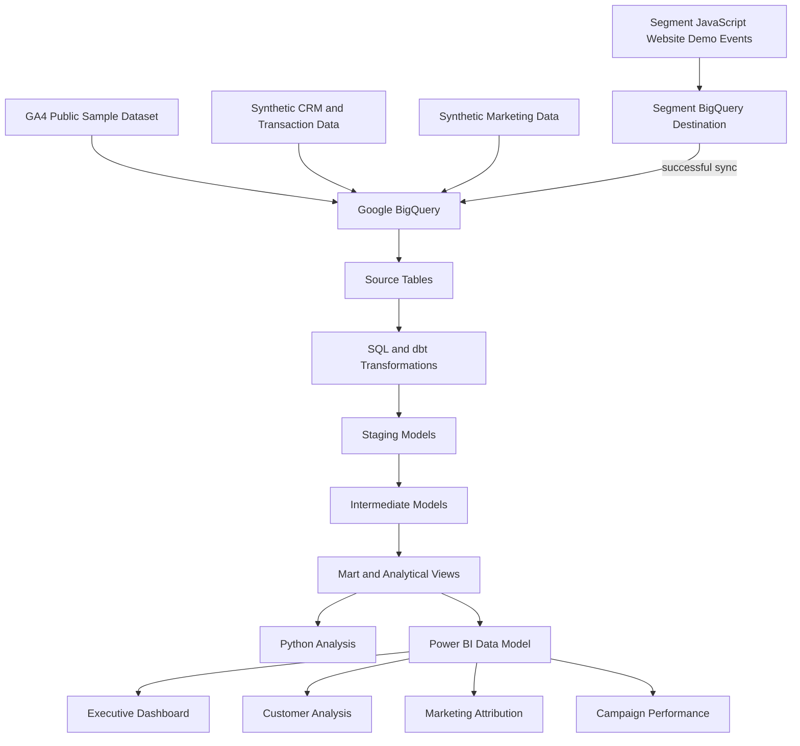

# Database Architecture – Customer 360 and Marketing Attribution Platform

## 1. Architecture Overview

The Customer 360 and Marketing Attribution Platform uses Google BigQuery as its central cloud data warehouse.

It combines synthetic CRM, order, product, marketing, customer session and web event data for customer analytics and marketing attribution. GA4 public sample data is analysed separately.

SQL and dbt transformations prepare the data for analytical views and downstream analysis. Python supports exploratory analysis and business insights, while Power BI provides interactive business intelligence reporting. Segment collects website demo events and successfully routes them to its BigQuery destination. GA4 public sample data is analysed separately.

## 2. Data Architecture

### Architecture Flow

## 1. Data sources provide synthetic CRM, marketing, order and website engagement information; GA4 public sample data is analysed separately.

## 2. Google BigQuery stores the project datasets.

## 3. Segment collects test website events (Identify, Page and Track) and successfully delivers them to its configured BigQuery destination. Segment reported 33 rows synced; 23 rows were individually verified across four destination tables.

## 4. SQL and dbt transformations prepare data for analysis.

## 5. dbt organizes transformations into 4 staging, 3 intermediate and 1 mart model. The latest recorded build reported 52 PASS (8 models and 44 tests).

## 6. Analytical views provide Customer 360, RFM, CLV and attribution results.

## 7. Python analyses customer, revenue, RFM, marketing spend, campaign and attribution data.

## 8. Power BI connects to the analytical data layer for business intelligence reporting.

## 9. Four interactive dashboard pages present business KPIs and insights.

Data integration note: GA4 public sample data and synthetic CRM data are analysed separately. Direct identity-level integration has not been established. Segment demo events are also a separate collection stream; do not describe them as identity-linked to CRM customers unless that linkage is implemented and validated.

## 3. Database Environment

| Component | Configuration |
| --- | --- |
| Cloud Platform | Google Cloud |
| Data Warehouse | BigQuery |
| Project ID | `customer360-mktg` |
| Dataset | `customer360` |
| Region | `asia-south1` |
| Environment | BigQuery Sandbox |

## 4. Core Source Tables

| Table | Purpose |
| --- | --- |
| `crm_customers_import` | Imported synthetic customer master information |
| `crm_orders` | Customer order transactions |
| `crm_order_items` | Order-level product details |
| `crm_products` | Product catalogue |
| `crm_marketing_spend` | Marketing expenditure and performance |
| `crm_campaigns` | Campaign master information |
| `crm_customer_sessions` | Customer session information |
| `crm_web_events` | Synthetic customer website journey events |
| `crm_attribution` | Detailed attribution records |
| `attribution_model_results` | Aggregated attribution results |

The recorded synthetic CRM dataset contains 20 customers, 40 orders, 40 order items, 10 products, 10 marketing spend records, 10 campaigns, 40 customer sessions and 200 web events.

## 5. Transformation and Analytical Layers

5.1 SQL and dbt

The project contains 77 saved SQL queries. SQL is used for source validation, analysis and business KPI preparation.

The dbt project contains:

- 4 staging models.
- 3 intermediate models.
- 1 mart model.
- 8 models in total.
- Latest recorded build: 52 PASS (8 models and 44 tests).

5.2 Analytical Views

| View | Purpose |
| --- | --- |
| `vw_customer_360` | Unified customer profile |
| `vw_customer_rfm` | Customer segmentation |
| `vw_customer_clv` | Customer lifetime value |
| `vw_attribution_summary` | Attribution performance summary |

5.3 Python Analysis Layer

Python is used for exploratory and business analysis on the analytical data. The recorded notebook is `Customer_360_Data_Analysis.ipynb`. Libraries include Pandas, NumPy, Matplotlib and Seaborn, with the BigQuery client used for data access.

Recorded outputs include `customer_segment_revenue.png`, `marketing_channel_roas.png` and `customer360_business_insights.csv`.

## 6. Key Relationships

- Customers connect to orders through `customer_id`.
- Orders connect to order items through `order_id`.
- Order items connect to products through `product_id`.
- Customer sessions connect to customers through `customer_id`.
- Sessions connect to campaign mapping through `session_id`.
- Attribution records contain customer and order identifiers through `customer_id` and `order_id`.
- Power BI relationships connect the imported analytical tables and views for reporting.

## 7. Attribution Architecture

The platform implements four attribution models:

## 1. First Touch: Credits the first recorded touchpoint.

## 2. Last Touch: Credits the last recorded touchpoint.

## 3. Linear: Distributes revenue equally across matched touchpoints.

## 4. Time Decay: Gives greater weight to touchpoints closer to the order date.

The attribution dataset contains 24 detailed records across four models and four matched orders.

- Matched attributed revenue: ₹113,580
- Total CRM order revenue: ₹908,000
- Attribution coverage: 12.51%

The remaining revenue is not covered by the current matched attribution data. Attribution coverage is therefore incomplete and should be considered when interpreting marketing performance.

## 8. Segment Event Collection and Warehouse Delivery

Segment workspace: `Kajal-Sharma`  
JavaScript source: `Customer 360 Website Demo`  
BigQuery destination: `Customer360_BigQuery_Destination`  
Destination schema shown in Segment: `customer_360_website_demo`

The website demo previously generated 10 test events in Segment Debugger: 5 Track, 3 Page and 2 Identify.

The Segment BigQuery destination is configured for Google Cloud project `customer360-mktg` in `asia-south1`. The service account was configured with BigQuery Data Editor and BigQuery Job User roles, and new service-account JSON credentials were updated in Segment.

**Current status: successfully synced and verified in BigQuery.** After the service-account credentials were updated, the Segment destination sync completed successfully. Segment's Overview reported **33 rows synced** (latest recorded successful sync: 17 November 2026, approximately 4:16 PM).

The following destination tables were individually opened and verified in BigQuery:

| BigQuery destination table | Verified rows |
| --- | ---: |
| `tracks` | 10 |
| `pages` | 5 |
| `identifies` | 4 |
| `user_sign_up` | 4 |
| **Total individually verified** | **23** |

The four table previews account for 23 individually verified rows. Segment's sync summary reported 33 rows overall; the remaining 10 rows were not individually itemized in the recorded table previews. These figures are intentionally reported separately and should not be described as a full 33-row table-level reconciliation.

The earlier `bigquery.jobs.create` permission error occurred before the credential update and was resolved for the subsequent successful sync.

Never store service-account private keys or JSON credential contents in architecture documentation or source control.

## 9. Power BI Reporting Architecture

Power BI is used as the business intelligence and visualization layer.

Four interactive dashboard pages have been developed:

| Dashboard | Main Purpose |
| --- | --- |
| Executive Dashboard | Revenue, orders, customers and monthly sales trends |
| Customer Analysis | RFM segmentation, CLV and customer-level performance |
| Marketing Attribution | Attribution models, channel spend and ROAS |
| Campaign Performance | Campaign spend, conversions, CTR and conversion efficiency |

### Dashboard Interactivity

- Date range slicer.
- Acquisition channel slicer.
- Synchronized slicers across report pages.
- Interactive charts and KPI cards.

## 10. Data Quality Controls

- Unique ID validation.
- Missing value checks.
- Customer-order relationship checks.
- Order-product relationship checks.
- Campaign date validation.
- Revenue reconciliation.
- Attribution completeness checks.
- Business KPI validation.
- dbt model tests (latest recorded build: 44 tests passed, alongside 8 models).

## 11. Data Limitations

- CRM and marketing records are synthetic.
- GA4 public sample data is analysed separately from synthetic CRM identities.
- Segment reported 33 rows synced; 23 rows were individually verified across the `tracks`, `pages`, `identifies` and `user_sign_up` tables. The remaining 10 reported rows were not individually itemized in the saved table previews.
- Only four orders currently have matched attribution touchpoints.
- Attribution coverage is approximately 12.51% of total CRM order revenue.
- Revenue-based ROI does not represent profit-based ROI.
- The platform is a portfolio project and does not represent a live production integration.

## 12. Future Architecture Enhancements

- Expand Segment event validation and reconcile the remaining reported sync rows at table level.
- Improve GA4 and CRM identity resolution.
- Increase attribution coverage.
- Integrate larger and more realistic datasets.
- Automate data refresh and reporting workflows.
- Introduce predictive customer analytics.
- Expand customer segmentation and campaign performance analysis.

## 13. Architecture Status

| Component | Status |
| --- | --- |
| Google Cloud Environment | Completed |
| BigQuery Dataset Setup | Completed |
| Source Data Preparation | Completed |
| SQL Transformations | Completed |
| dbt Models and Tests | Completed (latest recorded build: 52 PASS) |
| Analytical Views | Completed |
| Python Analysis | Completed |
| Customer Analytics | Completed |
| Marketing Attribution | Completed with coverage limitation |
| Power BI Data Model | Completed |
| Four Power BI Dashboards | Completed |
| KPI Validation | Completed |
| Segment Source Event Collection | Test events received |
| Segment BigQuery Credentials | Updated |
| Segment-to-BigQuery Warehouse Sync | Completed; 33 rows reported by Segment, 23 individually verified across four tables |

## Conclusion

The architecture demonstrates an end-to-end analytics workflow using Google BigQuery, SQL, dbt, Python, Segment and Power BI, from data preparation and customer analytics to marketing attribution and interactive business intelligence reporting.

The core project build, including Segment-to-BigQuery warehouse delivery, is complete. Segment reported 33 rows synced, with 23 individually verified across four destination tables. Final project closure now depends on the remaining documentation, presentation and end-to-end review.
